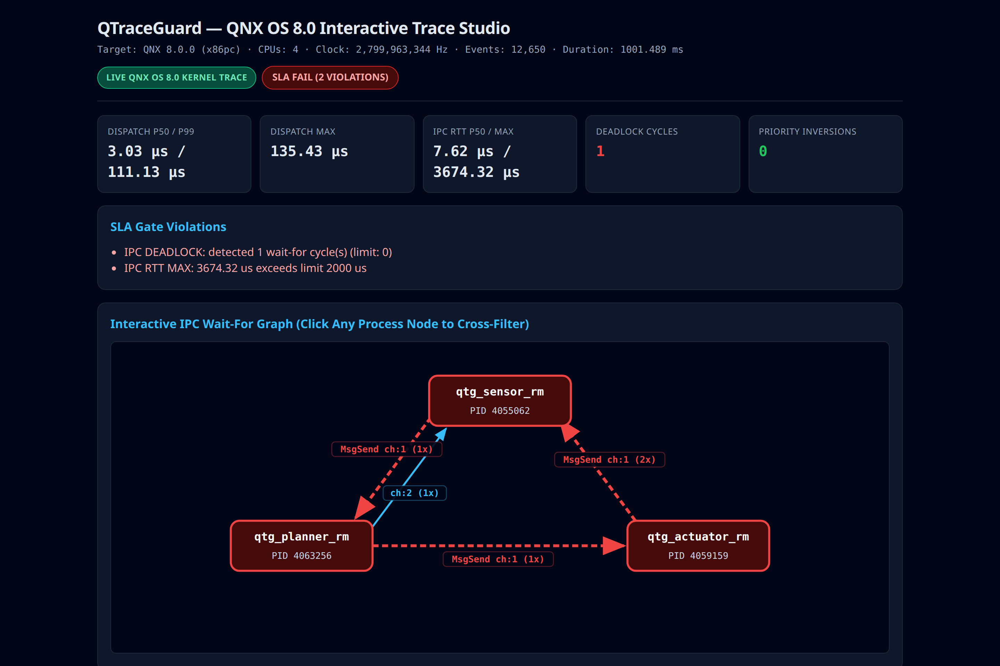
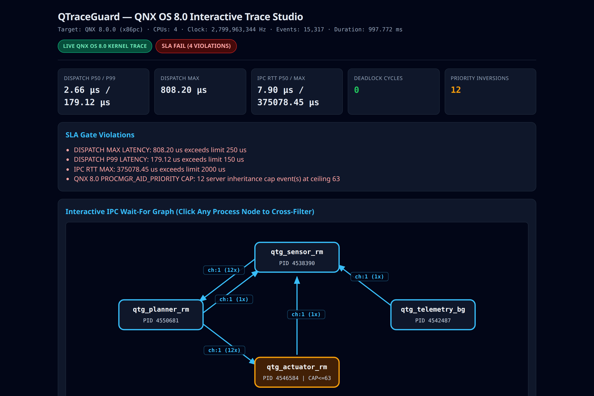
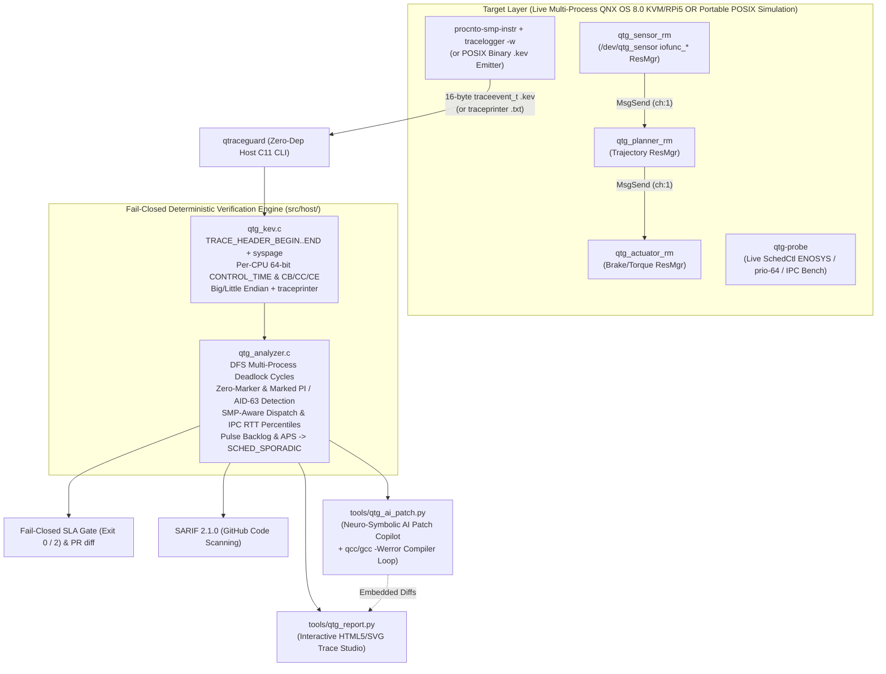

# QTraceGuard

[](https://github.com/mevlanayalcin/qtraceguard-qnx8/actions/workflows/qnx-ci.yml)
[](LICENSE)
[](benchmarks/QNX8_KVM_BENCHMARK.md)

**Fail-Closed QNX OS 8.0 Kernel Trace (`.kev`) Verifier · Compiler-Verified AI Patch Copilot · Interactive HTML5/SVG Trace Studio · QEMU/KVM CI Harness · 7-Module Codelab**

> Built for the **Devpost QNX Global Hackathon 2026** — targeting **Developer Tooling and Host Tools**, **Best Use of QNX-specific Technologies**, and **Best Codelab or Tutorial**.  
> **Verified live on real QNX OS 8.0 (`QNX noname 8.0.0 2026/10/30-09:10:05EDT x86pc`, `procnto-smp-instr` 2.8.0) under 4-vCPU KVM**, cross-compiled with real QNX SDP 8.0 `qcc` (`x86_64` & `aarch64le`, `-Wall -Wextra -Werror`, 0 warnings).  
> **100% MIT-licensed clean-room source** — redistributes **zero** proprietary BlackBerry QNX SDK headers, libraries, or OS images.

---

## Live QNX OS 8.0 Interactive Trace Studio

| 3-Process Live QNX 8.0 Deadlock (`qnx8_deadlock.kev`) | Live Non-Root `PROCMGR_AID_PRIORITY` Cap at `63` (`qnx8_aid-cap.kev`) |
| :---: | :---: |
|  |  |

---

## Try on Real QNX OS 8.0 Kernel Traces in 10 Seconds (Zero QNX SDP Required)

We bundle **5 clean-room binary `.kev` captures** recorded directly from live multi-process QNX OS 8.0 (`procnto-smp-instr`) in [samples/qnx8_live/](samples/qnx8_live/):

```bash
make host

# 1. Live 3-process healthy QNX 8.0 pipeline + /dev/qtg_sensor resmgr -> PASS (exit 0)
./build/qtraceguard check-sla samples/qnx8_live/qnx8_healthy.kev \
    --policy qemu/sla_policy.json --focus qtg

# 2. Live 3-process MsgSend deadlock (qtg_sensor_rm -> qtg_planner_rm -> qtg_actuator_rm -> qtg_sensor_rm) -> FAIL (exit 2)
./build/qtraceguard check-sla samples/qnx8_live/qnx8_deadlock.kev \
    --policy qemu/sla_policy.json --focus qtg \
    --json out/qnx8_deadlock.json --sarif out/qnx8_deadlock.sarif ; echo "Exit: $?"

# 3. Compiler-verified AI Root-Cause & QNX 8.0 C Patch Copilot (--verify-cc enforces -Werror)
python3 tools/qtg_ai_patch.py out/qnx8_deadlock.json \
    --out-md out/qnx8_deadlock_patch.md --verify-cc

# 4. Standalone Interactive HTML5/SVG Trace Studio (clickable nodes, CPU toggles, sortable tables, diff copy)
python3 tools/qtg_report.py out/qnx8_deadlock.json out/qnx8_deadlock.html
```

---

## Why QTraceGuard?

Safety-critical QNX OS 8.0 systems (automotive ADAS/cockpit, medical robotics, industrial control) rely on synchronous microkernel message passing (`MsgSend`/`MsgReceive`/`MsgReply`), Resource Managers (`iofunc_*`), priority inheritance, and deterministic scheduling. Five real QNX OS 8.0 failure modes routinely slip past unit tests into integration:

1. **Synchronous Multi-Process IPC Deadlock Cycles:** An upstream callback (`qtg_sensor_rm -> qtg_planner_rm -> qtg_actuator_rm -> qtg_sensor_rm`) deadlocks all processes in `STATE_SEND`/`STATE_REPLY`.
2. **`_NTO_CHF_FIXED_PRIORITY` Priority-Inversion Traps:** Disables QNX message-driven priority inheritance on a channel, letting mid-priority tasks preempt safety servers (`12/12` caught live on QNX 8.0, `431.39 µs` preemption).
3. **`PROCMGR_AID_PRIORITY` Unprivileged Ceiling (`63`):** Empirically verified on live QNX OS 8.0 `procnto-smp-instr`: when a `prio=120` client sends `MsgSend()` to a non-root (`setuid(1000)`) server lacking `PROCMGR_AID_PRIORITY`, **the kernel caps inherited priority at exactly `63`** — exposing the server to preemption by priority `64..119` tasks (`12/12` caught live in `qnx8_aid-cap.kev`). QTraceGuard detects both traps **even on third-party QNX traces with zero custom markers**!
4. **Pulse Queue Saturation & Fail-Closed CI Safety:** Detects undrained `MsgSendPulse()` queues (`40 sent / 4 recv` in `qnx8_pulse-storm.kev`) AND fails closed (`exit 2`) on empty traces, dropped `tracelogger` buffers, table overflow, or misspelled `--focus` filters.
5. **QNX 7.1 APS → QNX OS 8.0 `SCHED_SPORADIC` Migration:** QNX OS 8.0 omits legacy `[module=aps]` (`<sys/sched_aps.h>` removed; live `SchedCtl()` returns **`errno = 89 ENOSYS`** verified by `qtg-probe`). `qtraceguard migrate-aps` turns legacy APS `.kev` traces into compiler-verified QNX 8.0 `SCHED_SPORADIC` + `procmgr_ability()` C code with automatic `+20%` bankruptcy headroom.

---

## Architecture



---

## Verified Live on Real QNX OS 8.0 KVM & Hardened with LibFuzzer

Full empirical results & raw JSON telemetry: [**benchmarks/QNX8_KVM_BENCHMARK.md**](benchmarks/QNX8_KVM_BENCHMARK.md)

| Verification Layer | Command / Target | Real Observed Result |
| :--- | :--- | :--- |
| **Native QNX SDP 8.0 Cross-Builds** | `make qnx-x86_64 && make qnx-aarch64` (`qcc -Wall -Wextra -Werror`) | **0 warnings, 0 errors** on both `x86_64` & `aarch64le` |
| **Live 5-Scenario Multi-Process QNX 8.0** | `./qemu/qnx800_harness.sh --qnx-qemu <scen>` (`procnto-smp-instr`) | `healthy` **PASS (0)**; `deadlock`, `prio-inversion`, `aid-cap`, `pulse-storm` **FAIL (2)** |
| **1 / 2 / 4 vCPU KVM SMP Scaling** | `qtg-probe` + `tracelogger` on `procnto-smp-instr` (2.80 GHz) | `1 vCPU`: max `1185.38 µs` (FAIL) → `2 vCPU`: `144.37 µs` (PASS) → `4 vCPU`: `218.65 µs` (PASS) |
| **Compiler-Verified AI Patches** | `tools/qtg_ai_patch.py ... --verify-cc` (real `qcc -Vgcc_ntox86_64 -Werror`) | **6/6 patches compile with 0 errors** (`deadlock`, `prio-inversion`, `aid-cap`, `pulse-storm`, `aps-legacy`, `smp-runmask`) |
| **C11 Unit + E2E + ASan/UBSan Suite** | `make test && make asan` | **13/13 C11 unit** + **13/13 E2E** (incl. 5 live QNX 8.0 `.kev` & fail-closed) + **13/13 ASan/UBSan** + **3/3 `#ifdef __QNX__`** |
| **LibFuzzer + ASan + UBSan Hardening** | `make fuzz` (binary `.kev` + `traceprinter` + JSON/SARIF, `-max_len=327680`) | **47,642** initial + **10,794** full-length seeded runs, **0 crashes, 0 UB, 0 leaks** |

---

## Bring Your Own QNX OS 8.0 `.kev` Trace

Already running a QNX OS 8.0 target? Capture a trace and verify your own processes in 2 commands:

```bash
# On QNX OS 8.0 target (booted with procnto-smp-instr):
tracelogger -w -s 1 -n 48 -f /dev/shmem/my_app.kev

# Pull to Linux/macOS host and run fail-closed SLA gate + AI Patch Copilot:
./build/qtraceguard check-sla my_app.kev --policy qemu/sla_policy.json --focus my_app \
    --json out/my_app.json --sarif out/my_app.sarif
python3 tools/qtg_report.py out/my_app.json out/my_app.html
python3 tools/qtg_ai_patch.py out/my_app.json --out-md out/my_app_patch.md --verify-cc
```

*(Optional Compiler-in-the-Loop LLM mode: set `QTG_LLM_API_KEY` or `OPENAI_API_KEY`, plus optional `QTG_LLM_BASE_URL` / `QTG_LLM_MODEL`, and add `--llm --verify-cc`. Every synthesized C patch is compiled with `qcc`/`gcc -Werror` with automatic compiler-error feedback repair; offline runs remain 100% air-gapped deterministic.)*

---

## Full Build, Test & Native QEMU Commands

```bash
# Local host build, full test suite (13 C11 + 13 E2E + 3 QNX stub checks), sanitizers & fuzzing
make host
make test
make asan
make fuzz FUZZ_TIME=30
./qemu/qnx800_harness.sh --sim-ci

# Native QNX OS 8.0 KVM workflow (requires free myQNX QNX Everywhere SDP 8.0)
source ~/qnx800/qnxsdp-env.sh
make qnx-x86_64 qnx-aarch64
./qemu/qnx800_harness.sh --boot-qemu              # Terminal 1: builds & boots KVM QNX 8.0 VM
./qemu/qnx800_harness.sh --qnx-qemu deadlock      # Terminal 2: deploys 3-proc workload, captures .kev & verifies SLA
```

---

## Hands-On 7-Module Codelab

Start the complete hands-on tutorial: [**codelab/index.md**](codelab/index.md)

1. [Module 1: QNX OS 8.0 Setup, `myQNX` License & KVM QEMU Bring-Up](codelab/01-qnx8-setup-qemu.md)
2. [Module 2: Microkernel IPC & `iofunc_*` Resource Managers](codelab/02-ipc-and-resmgr.md)
3. [Module 3: Lab — Injecting, Catching & Fixing a 3-Process IPC Deadlock](codelab/03-deadlock-lab.md)
4. [Module 4: Lab — Priority Inversion, `_NTO_CHF_FIXED_PRIORITY` & `PROCMGR_AID_PRIORITY`](codelab/04-priority-inversion-lab.md)
5. [Module 5: Lab — QNX 7.1 APS Removal (`ENOSYS`) → QNX 8.0 `SCHED_SPORADIC`](codelab/05-aps-to-sporadic-qnx8.md)
6. [Module 6: Fail-Closed SLA Gates, AI Patch Copilot, LibFuzzer & SARIF in CI](codelab/06-ci-sla-gates.md)
7. [Module 7: QNX 8.0 Real-Time Cheatsheet & 8-Question Quiz](codelab/07-cheatsheet-and-quiz.md)

---

## Project Layout

| Path | Description |
| :--- | :--- |
| `include/` | Clean-room C11 headers (`qtg_kev.h`, `qtg_analyzer.h`, `qtg_rtos_shim.h`, `qtg_resmgr_demo.h`) |
| `src/host/` | Binary `.kev` & `traceprinter` codec (`qtg_kev.c`), fail-closed verifier (`qtg_analyzer.c`), CLI (`main.c`) |
| `src/target/` | Dual-target QNX 8.0 / POSIX shim (`qtg_rtos_shim.c`), multi-process `iofunc_*` workload (`qtg_resmgr_node.c`), live probe (`qtg_probe.c`) |
| `tools/qtg_report.py` | Zero-dependency interactive HTML5/SVG Trace Studio (clickable nodes, CPU lane toggles, sortable tables, diff copy) |
| `tools/qtg_ai_patch.py` | Neuro-symbolic AI Root-Cause & Compiler-Verified QNX OS 8.0 C Patch Copilot (`--verify-cc`, optional `--llm`) |
| `samples/qnx8_live/` | **5 clean-room live multi-process QNX OS 8.0 KVM `.kev` traces** for instant zero-SDP verification |
| `benchmarks/` | Live 1/2/4 vCPU KVM SMP scaling telemetry JSONs & full verification report (`QNX8_KVM_BENCHMARK.md`) |
| `qemu/` | Reproducible QNX 8.0 `mkqnximage` KVM CI harness (`qnx800_harness.sh`), `mkifs` buildfile (`qtg_qnx8.build`), `sla_policy.json` |
| `cmake/` | Clean-room QNX SDP 8.0 CMake cross-compilation toolchain (`qnx800-toolchain.cmake`) |
| `tests/` | 13 C11 unit tests (`test_runner.c`), 13 Python E2E tests (`test_e2e.py`), LibFuzzer harness (`fuzz_kev.c`), clean-room `#ifdef __QNX__` compile stubs |
| `.github/workflows/` | Automated CI (`qnx-ci.yml`): build, `qnx-compile-check`, tests, ASan/UBSan, LibFuzzer, AI patch verify & SARIF upload |
| `codelab/` | Complete 7-module QNX OS 8.0 hands-on tutorial + coding exercises + quiz |
| `docs/` | Rendered high-DPI screenshots of live QNX OS 8.0 interactive dashboards |
| `demo/` | `< 3 min` YouTube demo script (`DEMO_SCRIPT_3MIN.md`) & deterministic studio video renderer |

---

## License

MIT License — see [LICENSE](LICENSE). Contains **zero** proprietary QNX SDP binaries, libraries, or headers.
