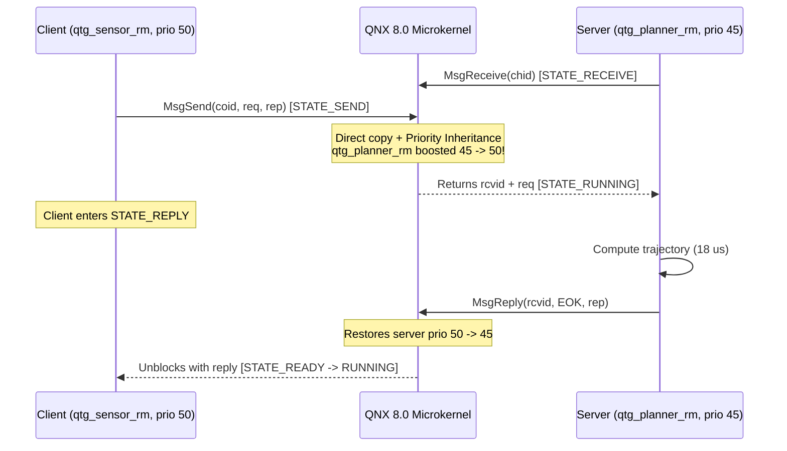

# Module 2: QNX Microkernel IPC & `iofunc_*` Resource Managers

**Estimated Time:** 10 minutes  
**Objective:** Understand how QNX OS 8.0 unifies device drivers, filesystems, and inter-service RPC on top of synchronous message passing, inspect our `iofunc_*` Resource Manager mounted at `/dev/qtg_sensor`, and run the healthy 3-process autonomous control pipeline.

---

## 2.1 Why QNX Is Different From Monolithic Kernels

In QNX OS 8.0, device drivers, network stacks, filesystems, and application services all run as **isolated user-space processes** communicating via the microkernel's synchronous message-passing IPC:



### The Five Core Primitives Used in `QTraceGuard`

| QNX 8.0 API | Purpose | Where in `QTraceGuard` |
| :--- | :--- | :--- |
| `ChannelCreate(flags)` | Creates a message/pulse receive endpoint (`chid`). Key flags: `_NTO_CHF_UNBLOCK`, `_NTO_CHF_PRIVATE`, `_NTO_CHF_FIXED_PRIORITY`. | `src/target/qtg_rtos_shim.c` |
| `ConnectAttach(...)` | Opens a client connection (`coid`) to a server `(nd, pid, chid)`. | `src/target/qtg_rtos_shim.c` |
| `MsgSend` / `MsgReceive` / `MsgReply` / `MsgError` | Synchronous zero-buffer rendezvous IPC using 64-bit `rcvid_t` with automatic **priority inheritance**. | `src/target/qtg_rtos_shim.c` |
| `MsgSendPulse(...)` | Non-blocking, fixed-size (5-byte payload: 8-bit code + 32-bit value) asynchronous notification; ideal for breaking cyclic dependencies. | `src/target/qtg_resmgr_node.c` |
| `resmgr_attach` + `iofunc_*` | Mounts a user-space server into the global pathname space (`/dev/qtg_sensor`), translating POSIX `open/read/write/devctl` into QNX messages. | `src/target/qtg_resmgr_node.c` |

---

## 2.2 Inspecting the QNX 8.0 Resource Manager Pattern

Open `src/target/qtg_resmgr_node.c` and look at `run_qnx8_resmgr_daemon()` (compiled under `#ifdef __QNX__`, exercised live during `--qnx-qemu healthy`):

```c
dispatch_t *dpp = dispatch_create();
iofunc_func_init(_RESMGR_CONNECT_NFUNCS, &g_connect_funcs,
                 _RESMGR_IO_NFUNCS, &g_io_funcs);
g_io_funcs.read   = qtg_io_read;
g_io_funcs.devctl = qtg_io_devctl;
iofunc_attr_init(&g_attr, S_IFCHR | 0666, NULL, NULL);

resmgr_attach(dpp, &rattr, "/dev/qtg_sensor", _FTYPE_ANY, 0,
              &g_connect_funcs, &g_io_funcs, &g_attr);

/* QNX 8.0 least-privilege best practice: lock PROCMGR_AID_PRIORITY and setuid(1000) */
qtg_shim_drop_privileges_keep_priority(true);
```

Inside `qtg_io_read()`, we clamp the reply to `min(full_len, _IO_READ_GET_NBYTES(msg))` and inject a custom user kernel trace marker using QNX OS 8.0's real simple-event macro:
```c
TraceEvent(_NTO_TRACE_INSERTSUSEREVENT, QTG_USER_MARKER, 0x52454144U, seq);
```
This lets `tracelogger` correlate `/dev/qtg_sensor` `read()` calls directly against microkernel scheduling and IPC events!

---

## 2.3 Running the Healthy Pipeline & Inspecting the Binary `.kev` Trace

### Option A: Bundled Live QNX OS 8.0 Capture (No SDP Needed)
```bash
./build/qtraceguard inspect samples/qnx8_live/qnx8_healthy.kev --limit 20
./build/qtraceguard check-sla samples/qnx8_live/qnx8_healthy.kev \
    --policy qemu/sla_policy.json --focus qtg
echo "Exit code: $?"
```

### Option B: Local Deterministic Simulation
```bash
./build/qtraceguard generate-demo healthy out/lab2_healthy.kev --iters 16
./build/qtraceguard inspect out/lab2_healthy.kev --limit 20
./build/qtraceguard check-sla out/lab2_healthy.kev --policy qemu/sla_policy.json
echo "Exit code: $?"
```

Look closely at what `inspect` and `check-sla` verify:
- The ASCII header block (`TRACE_CYCLES_PER_SEC`, `TRACE_CPU_NUM`, `TRACE_SYSPAGE_LEN`, `TRACE_LITTLE_ENDIAN`) is parsed directly from bytes `0..N` of the `.kev` file.
- Every 16-byte `traceevent_t` slot is decoded with **per-CPU 64-bit `CONTROL_TIME`** wraparound tracking and **per-CPU `CB/CC/CE`** combine reassembly so SMP buffers flushed out-of-order across cores sort cleanly into chronological order.
- `check-sla` enforces fail-closed verification (`0` deadlocks, `0` priority inversions, `0` dropped buffers, dispatch/IPC RTT budgets satisfied) and exits **`0` (`[SLA VERDICT] PASS`)**. *(Note: `analyze` always exits `0` for exploration; use `check-sla` in CI to enforce exit code `2` on violations!)*

---

**Next:** [Module 3: Lab — Injecting & Catching a 3-Process Cyclic IPC Deadlock →](03-deadlock-lab.md)
