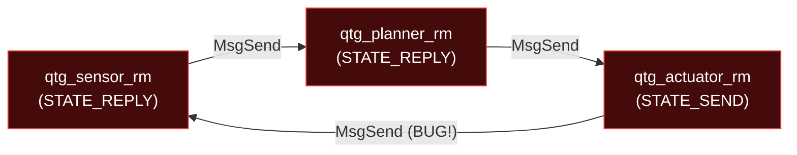

# Module 3: Lab — Injecting & Catching a 3-Process Cyclic IPC Deadlock

**Estimated Time:** 10 minutes  
**Objective:** Trigger a real 3-process synchronous `MsgSend` deadlock across three QNX OS 8.0 processes (`qtg_sensor_rm`, `qtg_planner_rm`, `qtg_actuator_rm`), pinpoint the exact cycle with `QTraceGuard`, generate a compiler-verified C remediation patch with `qtg_ai_patch.py`, and eliminate the cycle.

---

## 3.1 The Classic Microkernel Deadlock Anti-Pattern

Because `MsgSend()` blocks the caller in `STATE_SEND` / `STATE_REPLY` until the server calls `MsgReply()`, synchronous IPC graphs **must form a strict DAG** (Directed Acyclic Graph).

Watch what happens when an engineer adds a seemingly innocent "quick status check" from `qtg_actuator_rm` back to `qtg_sensor_rm` while handling a brake command:



All three QNX processes are now simultaneously blocked waiting for a reply from the next node in the ring!

---

## 3.2 Reproducing the 3-Process Deadlock

### Option A: Bundled Live QNX OS 8.0 Multi-Process Capture (Zero SDP Required — 5 Seconds!)
We include a genuine clean-room `.kev` trace captured from live 4-vCPU KVM `procnto-smp-instr` running 3 separate processes (`qtg_sensor_rm`, `qtg_planner_rm`, `qtg_actuator_rm`):
```bash
./build/qtraceguard check-sla samples/qnx8_live/qnx8_deadlock.kev \
    --policy qemu/sla_policy.json --focus qtg \
    --json out/lab3_live_deadlock.json --sarif out/lab3_live_deadlock.sarif
echo "Exit code: $?"
```

Verified output from live QNX OS 8.0 (`12,650` kernel events across `28` OS processes, `0` dropped buffers):
```text
[2] IPC Wait-For Deadlock Cycles (1 detected)
  CYCLE #1 (at 101.454 ms): P4055062:T1(tmp/qtg_sensor_rm) --[ch:1]--> P4063256:T1(tmp/qtg_planner_rm) --[ch:1]--> P4059159:T1(tmp/qtg_actuator_rm) --[ch:1]--> P4055062:T1(tmp/qtg_sensor_rm)

[SLA VERDICT] FAIL (2 violation(s))
  - IPC DEADLOCK: detected 1 wait-for cycle(s) (limit: 0)
  - IPC RTT MAX: 3674.32 us exceeds limit 2000 us
Exit code: 2
```

### Option B: Live QNX OS 8.0 QEMU Target (`tracelogger -w -s 1 -n 48`)
```bash
./qemu/qnx800_harness.sh --qnx-qemu deadlock
```

### Option C: Local Deterministic POSIX Simulation
```bash
./build/qtraceguard generate-demo deadlock out/lab3_deadlock.kev
./build/qtraceguard check-sla out/lab3_deadlock.kev \
    --policy qemu/sla_policy.json --json out/lab3_deadlock.json --sarif out/lab3_deadlock.sarif
echo "Exit code: $?"
```

In every mode, `qtg_resmgr_node.c` uses `TimerTimeout(_NTO_TIMEOUT_SEND | _NTO_TIMEOUT_REPLY)` (`35–75 ms`) + `MsgError(rcvid, ETIMEDOUT)` unwind so the 3-process cycle is genuinely entered, recorded into the `.kev` stream, and terminated cleanly without hanging CI.

---

## 3.3 Interactive Trace Studio & Compiler-Verified AI Patch Copilot

Render the interactive HTML5/SVG Trace Studio and run the compiler-verified AI Patch Copilot on the live QNX 8.0 capture:

```bash
python3 tools/qtg_report.py out/lab3_live_deadlock.json out/lab3_live_deadlock.html
python3 tools/qtg_ai_patch.py out/lab3_live_deadlock.json \
    --out-md out/lab3_deadlock_patch.md --verify-cc
cat out/lab3_deadlock_patch.md
```

Open `out/lab3_live_deadlock.html` in any browser:
- Notice the green **`LIVE QNX OS 8.0 KERNEL TRACE`** provenance pill and red **`SLA FAIL`** badge.
- Click any crimson process node (`qtg_sensor_rm`, `qtg_planner_rm`, `qtg_actuator_rm`) in the SVG Wait-For Graph to cross-filter all tables and highlight its multi-core timeline slices!
- Inspect the embedded **AI Root-Cause & Patch Copilot** unified diff verified with `-Wall -Wextra -Werror` (`qcc` when SDP 8.0 is sourced, `gcc` clean-room stubs in Linux CI).

---

## 3.4 Hands-On Coding Exercise: Break the Cycle & Turn CI Green

1. Open `src/target/qtg_resmgr_node.c` around line 72 (`actuator_thread`) and line 493 (`run_mp_actuator_process`).
2. Notice the buggy reverse callback:
   ```c
   /* BUG: synchronous reverse MsgSend creates sensor -> planner -> actuator -> sensor cycle */
   (void)qtg_shim_msg_send(..., sensor_coid, &cb, sizeof(cb), &cb_rep, sizeof(cb_rep), 75U);
   ```
3. Replace that synchronous reverse `MsgSend()` with an asynchronous non-blocking pulse (`qtg_shim_msg_send_pulse(..., sensor_coid, -1, QTG_SHIM_PULSE_CODE_PING, req.seq)`) — or pass sensor health downstream inside `qtg_ipc_request_t` so the IPC graph remains a strict DAG.
4. Rebuild (`make host`), regenerate the trace, and confirm `qtraceguard check-sla` now reports **`0` deadlock cycles**! *(Restore the file afterward with `git checkout src/target/qtg_resmgr_node.c` so the regression test suite keeps testing deadlock injection.)*

### Three Canonical QNX OS 8.0 Deadlock Prevention Rules
1. **Strict Send-Hierarchy (DAG):** Push telemetry downstream in the request struct; forbid synchronous upstream `MsgSend()` callbacks.
2. **Asynchronous Pulses (`MsgSendPulse`):** For upstream notifications, send a non-blocking 5-byte pulse — and monitor pulse queue depth (`qtraceguard` also catches pulse saturation in `samples/qnx8_live/qnx8_pulse-storm.kev`!).
3. **Worker Thread Pool + `_NTO_CHF_UNBLOCK`:** Pair multi-client servers with `thread_pool_create()` and `_NTO_CHF_UNBLOCK` so timed-out clients deliver `_PULSE_CODE_UNBLOCK`.

---

**Next:** [Module 4: Priority Inversion, `_NTO_CHF_FIXED_PRIORITY` & QNX 8.0 `PROCMGR_AID_PRIORITY` Ceilings →](04-priority-inversion-lab.md)
