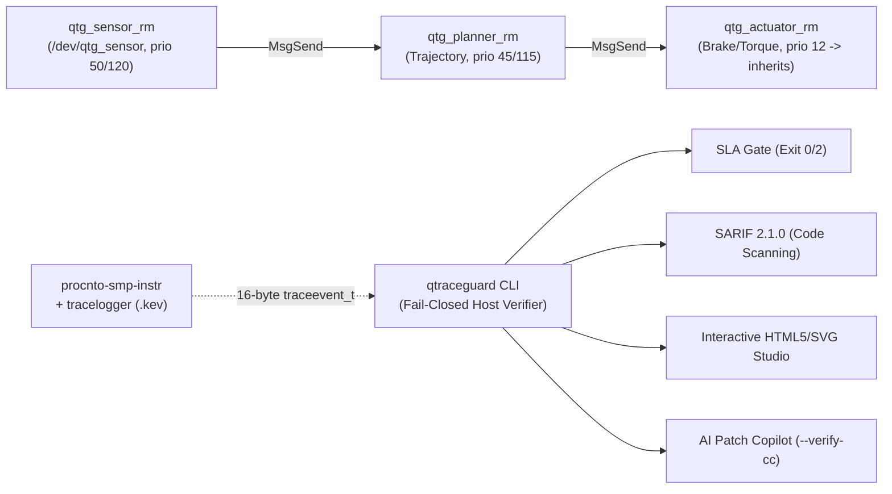

# Codelab: Mastering Deterministic IPC, Priority Inheritance & Kernel Tracing in QNX OS 8.0

**Duration:** ~60 minutes · **Level:** Intermediate–Advanced Systems / Embedded RTOS · **Hardware Required:** None (includes **5 bundled real multi-process QNX OS 8.0 KVM `.kev` traces** so every lab runs on real QNX 8.0 kernel data immediately — plus full native QEMU/KVM deployment when QNX SDP 8.0 is installed!)

Welcome to the hands-on **QTraceGuard Codelab** for the **QNX Global Hackathon 2026**. In 7 progressive modules, you will build, instrument, break, diagnose, auto-patch, and CI-gate a safety-critical multi-process **QNX OS 8.0** autonomous-control pipeline (`qtg_sensor_rm` → `qtg_planner_rm` → `qtg_actuator_rm` + `/dev/qtg_sensor`).



## Run on Real QNX OS 8.0 Kernel Traces in 10 Seconds (Zero SDP Needed)

```bash
make host
./build/qtraceguard check-sla samples/qnx8_live/qnx8_deadlock.kev \
    --policy qemu/sla_policy.json --focus qtg --json out/dl.json
python3 tools/qtg_ai_patch.py out/dl.json --out-md out/dl_patch.md --verify-cc
python3 tools/qtg_report.py out/dl.json out/dl.html
```

## What You Will Learn

1. **QNX OS 8.0 Setup & Zero-Bridge KVM Bring-Up** using free non-commercial *QNX Everywhere* (`myQNX`), `mkqnximage`, `procnto-smp-instr`, and live `qtg-probe` (`SchedCtl` `ENOSYS` = `89`).
2. **Microkernel IPC & Resource Managers** (`MsgSend`, `MsgReceive`, `MsgReply`, `MsgError`, `MsgSendPulse`, `iofunc_*`, `resmgr_attach`, `_NTO_CHF_UNBLOCK`).
3. **Catching & Fixing 3-Process Cyclic IPC Deadlocks** on live QNX OS 8.0 `.kev` streams (per-CPU `CONTROL_TIME` + per-CPU `CB/CC/CE` SMP combine reassembly).
4. **Preventing Priority Inversion & QNX 8.0's `PROCMGR_AID_PRIORITY` Ceiling (`63`) Trap** (`_NTO_CHF_FIXED_PRIORITY` vs. live `setuid(1000)` kernel capping).
5. **Migrating Legacy QNX 7.1 APS Workloads to QNX OS 8.0 `SCHED_SPORADIC`** (ordering `procmgr_ability()` before `pthread_setschedparam()`, plus CPU runmasks).
6. **Fail-Closed CI/CD Gates, Compiler-Verified AI Patching, LibFuzzer & SARIF 2.1.0** in GitHub Actions.

## Codelab Curriculum

| Module | Topic | Time | File |
| :--- | :--- | :---: | :--- |
| **Module 1** | QNX OS 8.0 Setup, `myQNX` License & KVM QEMU Bring-Up | 10 min | [01-qnx8-setup-qemu.md](01-qnx8-setup-qemu.md) |
| **Module 2** | QNX Microkernel IPC & `iofunc_*` Resource Managers | 10 min | [02-ipc-and-resmgr.md](02-ipc-and-resmgr.md) |
| **Module 3** | Lab: Injecting, Catching & Fixing a 3-Process IPC Deadlock | 10 min | [03-deadlock-lab.md](03-deadlock-lab.md) |
| **Module 4** | Lab: Priority Inversion, `_NTO_CHF_FIXED_PRIORITY` & `PROCMGR_AID_PRIORITY` | 10 min | [04-priority-inversion-lab.md](04-priority-inversion-lab.md) |
| **Module 5** | Lab: QNX 7.1 APS Removal (`ENOSYS`) → QNX 8.0 `SCHED_SPORADIC` | 8 min | [05-aps-to-sporadic-qnx8.md](05-aps-to-sporadic-qnx8.md) |
| **Module 6** | Fail-Closed SLA Gates, AI Patch Copilot, LibFuzzer & SARIF in CI | 7 min | [06-ci-sla-gates.md](06-ci-sla-gates.md) |
| **Module 7** | QNX 8.0 Real-Time Debugging Cheatsheet & 8-Question Quiz | 5 min | [07-cheatsheet-and-quiz.md](07-cheatsheet-and-quiz.md) |

## Quick Prerequisites Check

```bash
make host
./qemu/qnx800_harness.sh --check
```

- **Have QNX SDP 8.0 installed?** Boot QEMU in Terminal 1 (`./qemu/qnx800_harness.sh --boot-qemu`) and deploy/trace every lab natively in Terminal 2 (`./qemu/qnx800_harness.sh --qnx-qemu <scenario>`).
- **No QNX SDP installed yet?** Run every lab immediately on our **5 bundled real QNX OS 8.0 `.kev` captures** in [samples/qnx8_live/](../samples/qnx8_live/) OR generate custom scenarios locally via our portable POSIX RTOS simulation layer!

Start with **[Module 1: QNX OS 8.0 Setup & KVM QEMU Bring-Up](01-qnx8-setup-qemu.md) →**
